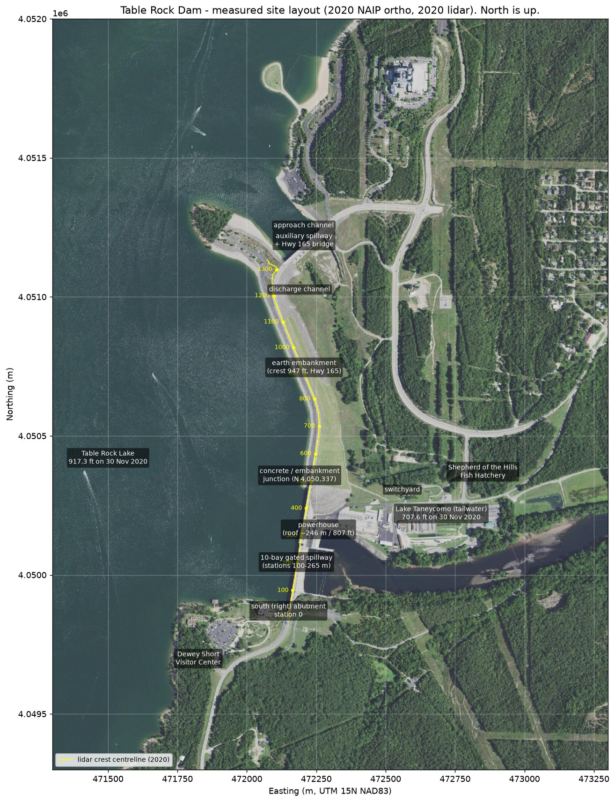

# Table Rock Dam (Branson, Missouri) — Research Database for a High-Detail 3-D Model

Compiled 2026-09-05. Subject: **Table Rock Dam**, White River mile 528.8, ≈ 8 mi south-west of
Branson, Taney/Stone counties, Missouri; owned and operated by the U.S. Army Corps of Engineers,
Little Rock District. Concrete gravity dam with a 10-gate tainter spillway and a 4-unit powerhouse,
flanked by rolled-earth embankments, plus an 8-gate auxiliary spillway (2005) through the north
abutment. Built October 1954 – August 1958; power on line 14 June 1959.

This directory is the database. It has three layers:

| Layer | What it is | Where |
|---|---|---|
| **A. Sourced research** | Eight dimension reports written by parallel research agents from web search results (≈ 4,000 lines, ≈ 900 URLs, every figure confidence-tagged) | `01-…md` … `08-…md` |
| **B. Measured geodata** | Public USGS/ESA data pulled directly from their S3 buckets and processed here: 3DEP lidar point clouds (2020 and 2021 epochs), 1 m DEM, 0.5 m surface models, NAIP orthos 2010/2014/2016/2020, seven Sentinel-2 scenes, USGS quadrangles 1956/1981/1989 and the crest-referenced products derived from them | `geodata/`, `scripts/`, `09-…md`, `10-…md` |
| **C. Synthesis** | Machine-readable spec sheet, measured geometry, modeling brief, gaps and acquisition plan | `specs.json`, `09-…md`, `11-…md`, this file |

## 1. Orientation (measured, authoritative)

The dam axis runs almost **north–south** (chord azimuth 356.6° true). Facing downstream (east):

* **South (right) abutment** — the bluff on which the **Dewey Short Visitor Center** stands (lake side of
  Hwy 165, ≈ 500 m SSW of the spillway). Crest station 0 = E 472,149.8 / N 4,049,850.0 (UTM 15N).
* **Concrete gravity section** (published 1,602 ft; lidar deck 481 m N–S at N 4,049,856–4,050,337):
  non-overflow monoliths (stations 0–100 m) → **ten gated bays (stations 100–265 m)** → **intake
  monoliths with the powerhouse at the toe (stations 265–357 m)** → non-overflow monoliths to the
  embankment junction (station ≈ 481 m).
* **Earth embankment** northward, carrying Missouri 165 on a 12–13 m crest at 947 ft, to the
  **auxiliary spillway (2005)** cut through the **north abutment** (Hwy 165 bridge deck 948.2 ft NAVD88
  at E 472,206 / N 4,051,182); approach channel from the lake on the north (Moonshine Beach cove),
  discharge channel south-east along the embankment toe.
* **Downstream (east):** the powerhouse tailrace into **Lake Taneycomo**, the **switchyard** ≈ 340 m
  ENE of the powerhouse, and the **Shepherd of the Hills Fish Hatchery** raceways on the **north bank**
  ≈ 750 m ENE of the spillway.

Two agent files written without live search results assumed a different orientation; they carry a
correction block at the top (`05-…md`, `07-…md`) and the measured layout above is authoritative.
Coordinates for 17 features: `geodata/lidar/feature_coordinates.json`; the crest centreline
(1 m stations, UTM and WGS84): `geodata/lidar/trd_crest_centreline.csv/.geojson`; every pier and
gate bay: `geodata/lidar/spillway_piers_and_bays.csv`.

## 2. Key facts

Published values (P) are from the agent reports with their confidence tags (V = several sources,
S = single source); measured values (M) are from the 2020 lidar/2020 NAIP (`09-…md`). Feet on the
USACE project datum (NGVD29) for P; NAVD88 for M (≈ +0.4 ft here).

| Item | Value | Tag |
|---|---|---|
| Total length / concrete section / embankments | 6,423 ft / 1,602 ft / 4,821 ft | P-V |
| Height above streambed / NID height | 252 ft / 260 ft | P-V / P-S |
| Concrete / embankment fill | 1,230,000 cu yd / 3,320,000 cu yd | P-V |
| Crest deck elevation | 947 ft (P-V); **288.76 m = 947.4 ft NAVD88** (M) | |
| Crest width | 35 ft concrete top (P-S); **12–13 m flat crest incl. shoulders** (M) | |
| Main spillway | 531 ft gated, 10 tainter gates 45 × 37 ft, ogee crest 896 ft, 558,000 cfs design (P-V); **11 pier marks at 16.5 m (54.1 ft) spacing, gated length 165 m** (M) | |
| Powerhouse | 4 × 50 MW Francis (200 MW; SWPA now lists 230 MW), Westinghouse 52.63 MVA generators, 4 × 18-ft penstocks, full-power flow 15,100 cfs (P); **roof 246 m / 807 ft, block 91.5 × 24.5 m at the toe north of the gates** (M) | |
| Auxiliary spillway (2005) | 8 tainter gates, 467-ft weir, 85 ft tall, top el. 948, 451,000 cfs, ≈ $65 M program (Granite $43.4 M, Kiewit phase 1) (P); **deck 289.0 m / 948.2 ft, channel floor 263 m / 863 ft → 85 ft** (M) | |
| Embankment slopes | not published; **upstream ≈ 2.8–3.1 H:1V, downstream ≈ 2.8–2.9 H:1V** (M) | |
| Pools (ft) | spillway crest 896 · conservation 915 (917 May–Nov) · flood 931 · surcharge 936 · top of dam 947 · record 935.47 on 27 Apr 2011 | P-V |
| Storage | 3,462,000 acre-ft total; 2,702,000 at 915; 760,000 flood control; drainage area 4,020 sq mi | P-V |
| Tailwater | Lake Taneycomo ≈ 702 ft idle → ≈ 711 ft at full generation (P); **707.6 ft NAVD88 on 30 Nov 2020** (M) | |
| Record release | ≈ 72,000 cfs late Dec 2015 (P-S); 2011 and 2017 ≈ 63,500–68,000 cfs | |
| Dates | authorized 18 Aug 1941; work began Oct 1954; first concrete 24 May 1955; dam complete Aug 1958; power 14 Jun 1959; units 3–4 1961; auxiliary spillway 2001–2005; Dewey Short Visitor Center 27 Apr 2012 (≈ 15,000 sq ft, LEED Gold, ≈ $8 M) | P-V |
| Identifiers | NID **MO30202** (High hazard); EIA plant 2166; GRanD 1026; USACE CWMS `Table_Rock_Dam`; NWS `TBRM7`; USGS 07053450 (below dam), 07053600/07053820 (Taneycomo) | P |
| Cost | ≈ $65 M original (1954–58) | P-S |

The full machine-readable set is in **`specs.json`**.

## 3. File map

| File | Contents |
|---|---|
| `01-engineering-specifications.md` | 622 lines; every structural dimension found, spillway/gate/powerhouse/elevation tables, NID record, open questions, 56 queries logged |
| `02-history-timeline.md` | 424 lines; chronology 1900s → 2026 with the physical/visual significance of each event, people, books, conflicts |
| `03-photography-catalog.md` | 537 lines; 24 ranked image sources, ≈ 110 image/collection records, feature × era coverage matrix, top-40 acquisition list |
| `04-documents-technical-literature.md` | 470 lines; top-25 documents (WES TR 2-504 model study, USACE Digital Library drawings, Master Plan DM index, USGS SIM 3499 bathymetry…), FOIA plan |
| `05-gis-remote-sensing-sources.md` | 566 lines; lidar/DEM/imagery/bathymetry/vector inventory with exact S3 paths (verified by download), datums, coordinates |
| `06-video-film-3d-assets.md` | 478 lines; top-30 videos (2008–2026 spillway releases, drone orbits, DVIDS public-domain B-roll), historic film leads, 3-D asset search |
| `07-site-context-surroundings.md` | 449 lines; 35-feature scene inventory (written from model memory — see its correction block), materials palette, LOD guidance |
| `08-hydrology-operations-data.md` | 449 lines; pool/storage tables, release chronology, generation data, live-data identifiers (CWMS/USGS/NWS/SWPA) |
| `09-measured-geometry-from-lidar.md` | measured crest, alignment, spillway bays, powerhouse, embankment slopes, auxiliary spillway, water surfaces, datum check |
| `10-geodata-products.md` | inventory of every file in `geodata/` with CRS, resolution, provenance and regeneration commands |
| `11-3d-modeling-brief.md` | scene tiers, origin/datums, terrain/structure/water pipelines, historical states, gaps and acquisition plan |
| `specs.json` | published + measured values with sources and confidence |
| `geodata/` | 143 MB of elevation, lidar, imagery, historical maps, metadata and figures (see `10-…md`) |
| `scripts/` | `fetch_dem.py`, `fetch_lidar_ept.py`, `fetch_sentinel2.py`, `extract_ustopo_ortho.py`, `crop_historical_topo.py`, `process_lidar.py`, `measure_structures.py`, `make_site_figure.py`, `assemble_geodata.py` — reproduce every product in ≈ 5 minutes with only Python and HTTPS |

## 4. What the geodata contains (highlights)

* **21.6 M classified lidar points** (30 Nov 2020, 3.9 pts/m²) over a 2.0 × 2.7 km area; full-density
  crops of the concrete section + powerhouse + hatchery (2.04 M pts), the auxiliary spillway (1.10 M) and
  the visitor center (0.85 M); a 1-of-16 thinned cloud of the whole area; the 2021 west-side epoch.
* **0.5 m DSM, nDSM, first-return intensity and class rasters** of the structures; a **DSM unrolled along
  the crest centreline** (whole dam at 1 m, concrete section at 0.5 m) that reads like an elevation
  drawing; 30 cross-sections (PNG + CSV) at 25–100 m stations and through the auxiliary spillway,
  powerhouse tailrace and visitor center.
* **1 m bare-earth DEM** (5 km box, two lidar projects merged), 2 m and 40 m context DEMs, hillshades.
* **Orthoimagery 2010 / 2014 / 2016 / 2020** (NAIP, 1–1.5 m, georeferenced) and **Sentinel-2** windows for
  seven dates including the 9 June 2025 spillway-release day.
* **USGS quadrangles**: 1956 pre-impoundment sheet ("TABLE ROCK DAM (UNDER CONSTRUCTION)", natural
  White River channel, borrow area), 1981 photorevision, 1989 edition, 1985 1:100,000.

## 5. Coverage and gaps

| Need | Status |
|---|---|
| Exterior massing of every structure | **Done** — lidar, DSM, orthos |
| Crest, pier, bay, powerhouse, embankment dimensions | **Measured** (09) — agree with published figures |
| Gate leaf/hoist detail, ogee profile, stilling basin floor, penstock/intake internals | **Not measured** — need WES TR 2-504, Design Memoranda and as-builts (FOIA plan in 04) |
| Lake bed | USGS SIM 3499 (2020 multibeam) identified, not downloadable here; 1956 contours included as a stopgap |
| Taneycomo bed | no public data |
| Photographs | ≈ 110 records catalogued with rights (03); construction 1955–57, 2009 aerial, 2011/2016/2017/2025 spillway events, 2022 interior press set; largest gaps: 1960s–1990s, powerhouse interior, close-range gate machinery |
| Video | 30 ranked (06); best aerial: June 2016 all-gates-open drone pair, April 2017 record-release drone; two public-domain DVIDS clips |
| Live data | CWMS/USGS/NWS/SWPA identifiers (08) |
| Site context | inventory exists (07) but must be re-verified; orientation corrected here |

**Next actions, in order:** (1) file the FOIA/records request listed in `04-…md` §10–11; (2) download
USGS SIM 3499 bathymetry; (3) re-run the ≈ 150 unexecuted queries logged at the end of files 03–08 (the
session's shared 200-query search budget ran out); (4) commission or licence a drone orbit of the
concrete section; (5) confirm the NAVD88/NGVD29 shift with NGS VERTCON.

## 6. Provenance, licences and caveats

* USGS 3DEP lidar/DEM, US Topo/HTMC maps and NAIP imagery are U.S. public domain. Sentinel-2 data are
  © ESA/Copernicus, free to use with attribution (CC BY-SA 3.0 IGO). Third-party photographs and videos
  in the catalogs are **linked, not copied**; rights are recorded per item.
* The research environment could search the web but could not open pages (fetch blocked), so agent
  reports quote search-result summaries; URLs are verbatim from results unless marked "(unverified)".
  Direct HTTPS access was possible only to a few public S3/GCS buckets, which is where all the geodata
  came from. The NID, USACE, USGS and ScienceBase web services were blocked — their identifiers are
  recorded for use elsewhere.
* Elevations: measured values are NAVD88; published USACE values are NGVD29. Do not mix without the
  ≈ 0.4 ft shift (see `09-…md` §2).
